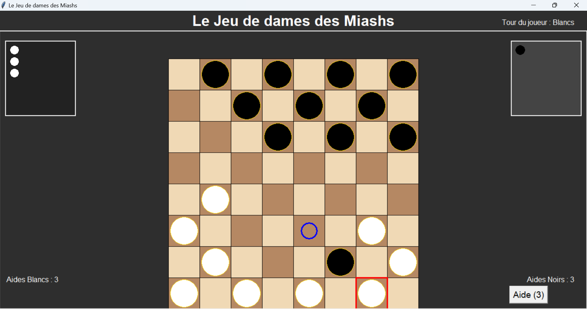

# Le Jeu de dames des Miashs

Jeu de dames en Python avec interface graphique, à deux joueurs ou contre l'ordinateur.

Projet universitaire, Algorithmique et programmation, L2 MIASHS, Université Paris Nanterre, 2024-2025.

## Aperçu

## Fonctionnalités

- Partie à deux joueurs sur le même ordinateur (1 vs 1)
- Partie contre l'ordinateur (1 vs IA) : l'IA joue en priorité les coups qui capturent
- Système d'aide : 3 aides par joueur pour afficher les déplacements possibles d'une pièce
- Promotion des pions en dames
- Affichage des pièces capturées et détection de la fin de partie
- Plein écran (F11 / Échap) et musique de fond

## Technologies

Python 3, Tkinter (interface), Pygame (musique).

## Lancer le projet

1. Installer Python 3 puis Pygame : `python -m pip install pygame`
2. Lancer le jeu : `python jeu_de_dameV2.py`
